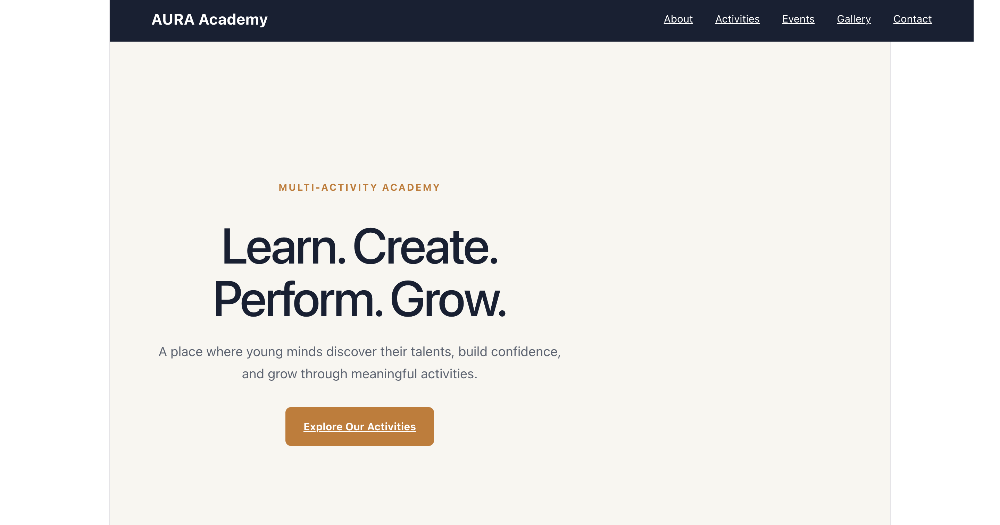
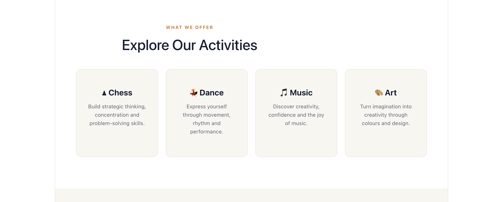
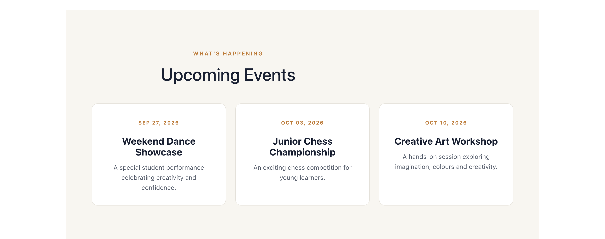

# AURA Academy

*A modern multi-activity academy website prototype built with React and Vite.*

AURA Academy is a fictional academy website created to explore modern frontend development and demonstrate how an academy can present its activities and upcoming events through a clean, engaging web experience.

---

## Website Preview

<!-- Replace these image paths with the screenshots you save in docs/screenshots/ -->



*Homepage — introducing AURA Academy and its offerings.*

## Screenshots

### Activities

Showcase the different activities offered by the academy.



### Upcoming Events

A dedicated section for presenting upcoming academy events.




---

## Features

- **Navigation:** Move between the main sections of the website.
- **Hero section:** Introduces the academy with a prominent landing-page design.
- **Activities section:** Presents the academy's different activities.
- **Upcoming events:** Displays an events section.
- **Component-based architecture:** Built using reusable React components.
- **Modern visual design:** Clean styling and a structured page layout.

## Tech Stack

- React
- Vite
- JavaScript
- HTML
- CSS

## Run Locally

### Prerequisites

Install [Node.js](https://nodejs.org/) and npm.

### Setup

Clone the repository and enter the project directory:

```bash
git clone YOUR_REPOSITORY_URL
cd YOUR_PROJECT_FOLDER
```

Install dependencies:

```bash
npm install
```

Start the development server:

```bash
npm run dev
```

Open the local URL printed in your terminal.

## Project Structure

```text
.
├── public/
├── src/
├── docs/
│   └── screenshots/
│       ├── homepage.png
│       ├── activities.png
│       ├── events.png
│       └── layout.png
├── index.html
├── package.json
└── README.md
```

*The structure above illustrates the intended screenshot locations; adjust it to match the actual project files.*

## Project Purpose

This prototype was built as a learning project to practise React component structure, frontend styling, page layout, and the presentation of information through a website.

It is a demonstration project, not a claim of a deployed or production-ready academy platform.

---

**Built by [Krish](https://github.com/krish-tech-builds)**